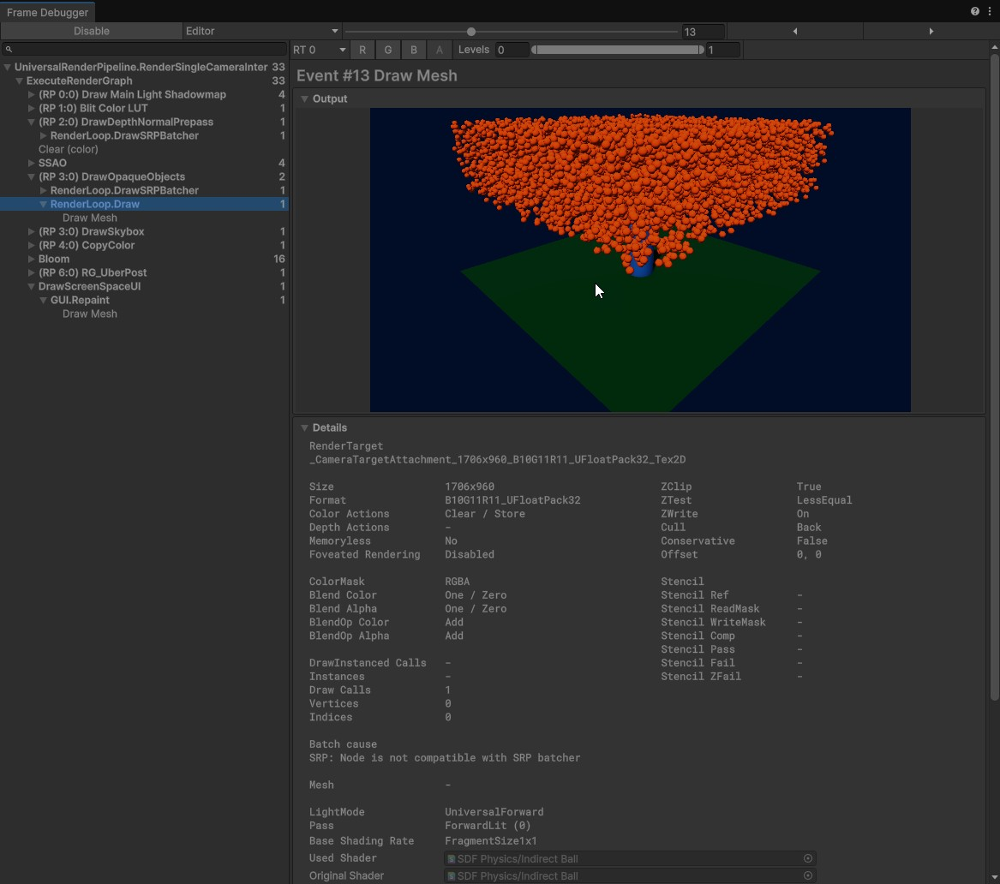

# 10,000 balls against a signed distance field

Unity 6.3 URP implementation of ten thousand GPU-instanced balls colliding with an offline-baked signed distance field (SDF). The project uses no `Collider`, `Rigidbody`, GameObject, or MonoBehaviour per ball.

## Run

1. Open the project with Unity 6000.3.24f1.
2. Open `Assets/SdfPhysics/Scenes/SdfPhysics.unity`.
3. Press Play.

`SdfPhysics` contains the bake settings, the simulation controller, the renderer, and the performance UI. 
The scene is configured for 10,000 balls, but ball amount and simulation parameters can be changed in `BallSimulationController`. 
## Bake the SDF

`Assets/SdfPhysics/Generated/SdfVolume.asset` holds the baked data.

To bake it again after changing the static ground or cylinder:

1. Select `SdfPhysics` in the scene.
2. In **Sdf Bake Settings**, verify that **Ground** and **Cylinder** point to the scene MeshFilters.
3. Select **Bake SDF volume** in the component Inspector.

The editor baker samples a `192 x 128 x 192` volume covering `(-5.25, -0.5, -5.25)` to `(5.25, 6, 5.25)`. It serializes one half-float signed distance per voxel. The output survives reimport and is never baked on scene load or during play.

This baker intentionally supports the required default primitives only: a Plane and a Cylinder, both uniformly scaled. The plane is a finite footprint with solid space below it; this keeps balls on the visible upper surface.

## Collision and simulation

At startup, `SdfVolumeRuntime` copies the serialized half-float data to a `NativeArray<ushort>`. `BallSimulationJob`, an `IJobFor` with `[BurstCompile]`, runs over persistent position, velocity, rest-time, and sleep-state arrays.

Each fixed simulation step is `1 / 120` second, with up to 4 such steps per rendered frame. Within a step, a ball gets extra collision checks when its predicted travel exceeds the smaller of its radius and an SDF cell width, up to 16 collision checks. This keeps checks close together at the falling speeds in this scene. For each collision check the job:

1. Integrates gravity and predicts a position.
2. Samples the SDF once at that position.
3. Computes the distance-field gradient from the same eight voxel values.
4. When the sphere penetrates or enters the tiny surface-skin gap, moves it to the edge of that gap along the normalized gradient.
5. Removes inward velocity, applies bounciness only above a speed threshold and accumulates quiet contact time until the ball sleeps.

Ball-vs-ball collision is intentionally not implemented, as required by the brief.

In an isolated Unity 6000.3.24f1 batch check using the committed SDF, all 10,000 scene-spawned balls were asleep after 600 simulation steps (five seconds). None ended outside the SDF volume or more than 1 cm inside a surface. A separate thin-obstacle check sent a ball across a 0.1 m slab at 120 m/s; the adaptive job stopped it on the entry side. These checks exercise the physics job and baked asset, not the rendered frame rate.

## Rendering

`BallRenderer` packs every ball as one `float4`: world position plus radius. At 10,000 balls this uploads **160 KB per frame**. It then issues one `Graphics.RenderMeshIndirect` command.

The ball mesh is a generated 20-triangle icosahedron, stored at `Assets/SdfPhysics/Generated/BallIcosphere.mesh`. Ten thousand instances therefore submit about 200,000 source triangles before visibility and rasterization work.

Frame Debugger verification at 10,000 balls:

- Event: `RenderLoop.Draw -> Draw Mesh`
- Shader: `SDF Physics/Indirect Ball`
- Output: the balls only
- Draw Calls: **1**

The Frame Debugger leaves the instance count blank because the indirect GPU command buffer supplies it; the command is initialized with an instance count of 10,000.

## Measured results

The following Editor measurements below.
Measurement environment: Unity Editor. CPU - Intel Core i5-11600KF @ 3.90 GHz GPU- NVIDIA GeForce RTX 2070 SUPER

| Setting | Average Frame time | FPS |
| --- | --- | --- |
| 10,000 balls | 4.24ms | 235.8 |
| 100,000 balls | 9.47 ms | 105.6 |
| 200,000 balls | 17.42 ms | 57.4 |

## Known limitations and next improvements

- The static SDF baker is built only for these plane and cylinder
- Balls have no shadow-caster pass. Adding indirect shadows would require a matching shadow pass
- When the ball happens to be outside the volume data - it is respawned, as described above.
- The default spawn and gravity do not produce speeds that may break the collisions. But some extreme speeds may.
- With another day, I would add an automated SDF probe visualization and profile a standalone build on the submission hardware
